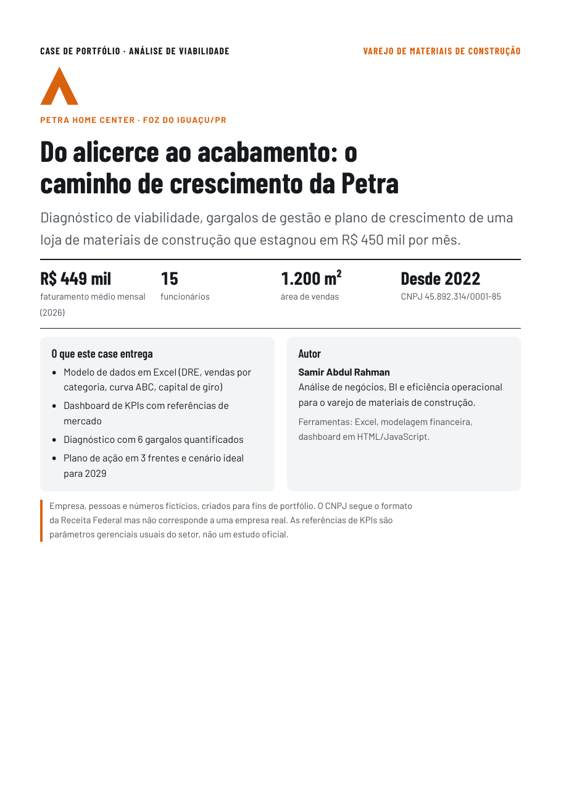

# Petra Home Center · Análise de viabilidade no varejo de materiais de construção

Case de portfólio: diagnóstico financeiro e operacional de uma loja de materiais de construção que estagnou em R$ 450 mil de faturamento por mês, e plano de crescimento até 2029.

> Empresa, pessoas e números fictícios, criados para fins de portfólio.

## Contexto

A Petra Home Center (Foz do Iguaçu/PR, 15 funcionários, 1.200 m²) atende três públicos: famílias em reforma (B2C), construtoras e especificadores (B2B) e compradores da Tríplice Fronteira. Os sócios querem entender por que a loja parou de crescer e o que fazer.

## O problema em números (2026)

| Indicador | Atual 2026 | Referência | Meta 2029 |
|---|---|---|---|
| Faturamento médio mensal | R$ 448.889 | — | R$ 760.184 |
| Margem bruta | 22,2% | ≥ 30% | 30,6% |
| Margem EBITDA | 0,2% | ≥ 8% | 10,4% |
| Lucro líquido no ano | −R$ 84.763 | — | R$ 498.844 |
| Ciclo financeiro | 104 dias | ≤ 45 dias | 43 dias |
| Faturamento por funcionário | R$ 29.926 | ≥ R$ 50.000 | R$ 50.679 |
| Nota de saúde (0 a 100) | 38 · Em risco | — | 97 · Saudável |

## Principais conclusões

1. Material básico é 60% das vendas, mas só 35% do lucro bruto (margem de 13%).
2. A loja opera 3% abaixo do ponto de equilíbrio. O problema é margem, não despesa fixa.
3. O ciclo financeiro de 104 dias prende R$ 1,31 milhão em estoque e contas a receber.
4. A equipe está dimensionada para pátio e carga, não para venda consultiva.

## Plano de ação

Três frentes e doze iniciativas: **mix e margem** (showroom de acabamentos, centro de cores, programa de especificadores, preço por margem-alvo), **compras e capital de giro** (compras em rede, entrega direta de fábrica, estoque por curva ABC, política de crédito B2B) e **eficiência comercial** (frete com valor mínimo, adquirência, equipe consultiva, canal Tríplice Fronteira).

## Conteúdo do repositório

| Pasta | Arquivo | O que é |
|---|---|---|
| `relatorios/` | `Petra_Home_Center_Analise_de_Viabilidade.pdf` | Relatório completo (16 páginas) |
| `relatorios/` | `Petra_Home_Center_Dashboard.pdf` | Dashboard de KPIs, cenário atual e ideal |
| `dados/` | `Petra_Home_Center_Cenario_Atual_2026.xlsx` | Modelo preenchido, cenário atual |
| `dados/` | `Petra_Home_Center_Cenario_Ideal_2029.xlsx` | Modelo preenchido, cenário ideal |
| `dados/` | `Modelo_Viabilidade_em_branco.xlsx` | Modelo para uso em outras lojas |
| `docs/` | `index.html` | Versão web do case (GitHub Pages) |
| `docs/` | `dashboard.html` | Dashboard interativo: envie uma planilha e veja os KPIs |

## Como usar o dashboard

1. Abra `docs/dashboard.html` no navegador (ou pelo GitHub Pages).
2. Arraste um dos arquivos da pasta `dados/` para a área "Inserir dados da empresa".
3. Troque o tipo de gráfico e o padrão de cores pelos botões do painel.

## Métodos e ferramentas

Excel (DRE gerencial, curva ABC, capital de giro, 13 KPIs com fórmulas), modelagem de cenários, dashboard em HTML/JavaScript (Chart.js, SheetJS), análise de mix e margem, ponte de resultado.

## Autor

**Samir Abdul Rahman** · Análise de negócios, BI e eficiência operacional para o varejo de materiais de construção.
LinkedIn: [adicione o link do seu perfil]
